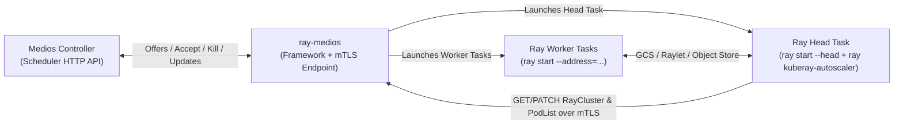

# Ray on Medios (`ray-medios`)

`ray-medios` is a [Medios](https://github.com/medios-lab/medios) scheduler framework for running [Ray](https://www.ray.io/) clusters. It uses KubeRay as its behavioral reference: it runs Ray's unmodified `ray kuberay-autoscaler` inside the head task against an HTTPS mutual-TLS endpoint served by `ray-medios`, keeping demand calculation, worker selection, draining, and task/actor scheduling inside Ray while reconciling Ray head and worker nodes into Medios tasks.

> **Status (`v0.1.0` — Preview):** Functional preview release tested with Ray 2.60.0 on Medios `v0.1.14`. See [Known Limitations](#known-limitations) and [SECURITY.md](SECURITY.md) before deploying.

## How It Works



1. `ray-medios` loads a KubeRay-shaped `RayCluster` JSON record into its store and subscribes to the Medios controller under the framework name `ray`.
2. From incoming Medios offers matching `-containerizer`, `-node-attribute`, and `-store`, it launches the head task first, reserving all required Ray ports explicitly.
3. Once the head task is `TASK_RUNNING`, `ray-medios` launches worker tasks to match `spec.workerGroupSpecs[].replicas` (packing multiple Ray nodes onto a single offer in one `ACCEPT` when capacity permits).
4. When `spec.enableInTreeAutoscaling` is `true`, the head task runs `ray kuberay-autoscaler` against `ray-medios`'s HTTPS mTLS endpoint. The autoscaler patches `replicas` and `scaleStrategy.workersToDelete`; `ray-medios` reconciles those edits into Medios task launches and kills.
5. On `SIGINT` or `SIGTERM`, `ray-medios` sends `TEARDOWN` to the Medios controller, ending the cluster's tasks.

## Compatibility & Support Matrix (`v0.1.0`)

| Component | Tested / Required Version | Notes |
| :--- | :--- | :--- |
| Medios Core | `>= v0.1.14` | Requires `TaskInfo.principal`, store mounts, and `docker.network: HOST` for `docker_shell` |
| `medios-sdk-go` | `v0.15.0` | Go scheduler client library |
| Ray (in task image) | `2.60.0` | Image must provide `ray`, `sh`, `base64`, and `mktemp` on `PATH` |
| Go (to build from source) | `>= 1.25.0` | |
| Containerizers | `medios`, `docker_shell` | Both verified for head + worker jobs and autoscaling scale-up/scale-down |

## Installation

### Download a release binary

Download the prebuilt archive for your platform (`linux/amd64`, `linux/arm64`, `darwin/arm64`) from the [GitHub Releases](https://github.com/medios-lab/ray-medios/releases) page, verify its SHA-256 checksum, and place `ray-medios` on your `PATH`.

### Install with Go

```sh
go install github.com/medios-lab/ray-medios/cmd/ray-medios@v0.1.0
```

### Build from source

```sh
git clone https://github.com/medios-lab/ray-medios.git
cd ray-medios
go build -o ray-medios ./cmd/ray-medios
./ray-medios -version
```

## Quickstart

See [examples/README.md](examples/README.md) for runnable `RayCluster` JSON manifests ([fixed](examples/raycluster-fixed.json) and [autoscaling](examples/raycluster-autoscaling.json)) and `openssl` commands for creating mutual-TLS certificates.

### 1. Create a Ray auth token

```sh
openssl rand -hex 32 > auth.token
chmod 600 auth.token
```

### 2. Launch a fixed-size cluster

```sh
ray-medios \
  -controller http://<medios-controller>:5150 \
  -user <os-user> \
  -principal operator:<your-name> \
  -record examples/raycluster-fixed.json \
  -image <your-ray-image> \
  -containerizer docker_shell \
  -node-attribute pool=compute \
  -worker-ports 8 \
  -auth-token-file auth.token
```

When the head launches, `ray-medios` logs the Ray dashboard URL (`dashboard http://<node-address>:<port>`). Submit jobs to the dashboard's `/api/jobs/` endpoint with `Authorization: Bearer $(cat auth.token)`.

### 3. Launch with Ray's stock autoscaler enabled

Use a record with `"enableInTreeAutoscaling": true` (such as [examples/raycluster-autoscaling.json](examples/raycluster-autoscaling.json)) and pass all nine mutual-TLS endpoint flags together:

```sh
ray-medios \
  -controller http://<medios-controller>:5150 \
  -user <os-user> \
  -principal operator:<your-name> \
  -record examples/raycluster-autoscaling.json \
  -image <your-ray-image> \
  -containerizer docker_shell \
  -node-attribute pool=compute \
  -worker-ports 8 \
  -auth-token-file auth.token \
  -endpoint-listen 0.0.0.0:8443 \
  -endpoint-host <address-reachable-from-head-node> \
  -endpoint-port 8443 \
  -tls-server-cert server.crt \
  -tls-server-key server.key \
  -tls-client-ca ca.crt \
  -autoscaler-ca ca.crt \
  -autoscaler-cert client.crt \
  -autoscaler-key client.key
```

### 4. Mount Medios stores (optional)

Repeat `-store name=path` to mount Medios stores read-write in every Ray node's task. Pass `-head-stores-read-only` if the head should mount stores read-only (note: Ray Train requires a read-write mount on the head).

## CLI Reference

| Flag | Required | Description |
| :--- | :--- | :--- |
| `-version` | No | Print build version and exit |
| `-controller` | Yes | Medios controller URL |
| `-user` | Yes | OS user the tasks run as on Medios nodes |
| `-record` | Yes | Path to the `RayCluster` JSON file |
| `-principal` | Yes | Task principal: `operator:<name>`, `team:<name>`, or `run:<id>` |
| `-image` | Yes | Container image with `ray`, `sh`, `base64`, and `mktemp` on `PATH` (no conflicting `ENTRYPOINT` under `docker_shell`) |
| `-containerizer` | Yes | Target Medios containerizer: `medios` or `docker_shell` |
| `-node-attribute` | Yes (1+) | `name=value` node attribute required besides containerizer (repeatable) |
| `-worker-ports` | Yes | Ports reserved per Ray node for Ray worker processes and attached drivers (`>= 1`) |
| `-auth-token-file` | Yes | File containing the cluster's Ray auth token |
| `-store` | No | `name=path` Medios store mount for every Ray node (repeatable) |
| `-head-stores-read-only` | No | Mount each `-store` read-only in the head task |
| `-endpoint-listen` | With autoscaler | `host:port` the HTTPS mTLS endpoint binds |
| `-endpoint-host` | With autoscaler | Hostname/IP the autoscaler connects to (must match server cert SAN) |
| `-endpoint-port` | With autoscaler | Port the autoscaler connects to |
| `-tls-server-cert`, `-tls-server-key`, `-tls-client-ca` | With autoscaler | PEM files for the HTTPS endpoint server and client CA |
| `-autoscaler-ca`, `-autoscaler-cert`, `-autoscaler-key` | With autoscaler | PEM files delivered to the autoscaler in the head task |

## Known Limitations (`v0.1.0`)

- **In-memory state store:** Cluster desired state and pod records live in process memory; restarting `ray-medios` loses cluster state.
- **No stream reconnect or reconciliation:** If the Medios controller closes the event stream, `ray-medios` exits with status `1`.
- **No node replacement:** If a Ray head or worker task ends unexpectedly, `ray-medios` stops and tears down the framework.
- **Autoscaler supervision:** The stock autoscaler runs as a background process inside the head task and is not restarted independently if it exits.
- **Record constraints:** Records setting `spec.idleTerminationOptions`, group `resources`, sizing `rayStartParams` (`num-cpus`, `num-gpus`, `memory`), container env `valueFrom`, or framework-managed env variables are refused.
- **`docker_shell` networking:** Tasks run in the node's network namespace (`docker.network: HOST`) because several Ray head/worker agents bind `--node-ip-address` directly.
- **Patch reaction latency:** Autoscaler patches take effect on the next Medios scheduler event (up to one controller heartbeat interval when offers are suppressed).
- **Credential transport:** See [SECURITY.md](SECURITY.md) for how `RAY_AUTH_TOKEN` and autoscaler mTLS material are passed to tasks.

## Documentation & Examples

- [Endpoint Contract](docs/endpoint-contract.md) — HTTP/JSON Patch contract served to `ray kuberay-autoscaler`.
- [Task Mapping](docs/task-mapping.md) — How Ray heads and workers map onto Medios tasks, ports, resources, containerizers, and stores.
- [Examples](examples/README.md) — Starter `RayCluster` records and mTLS setup.
- [XGBoost Cover Type Notebook](notebooks/xgboost-covtype/) — End-to-end Ray Train + Ray Data example with a container `Dockerfile`.

## License

Licensed under the [Apache License, Version 2.0](LICENSE). Copyright 2026 medios-lab.
